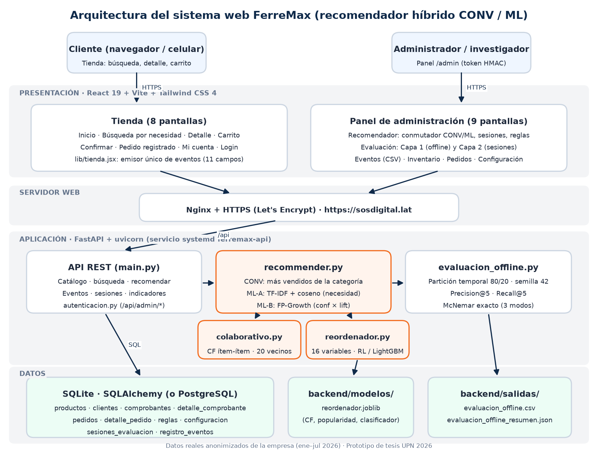

# Anexo 10. Gestión Scrum, arquitectura y diseño técnico del sistema FerreMax

Este anexo reúne:

- la gestión del desarrollo con Scrum: product backlog y sprints;
- la arquitectura del sistema;
- el diccionario de datos;
- la lista de servicios (endpoints);
- el plan de pruebas.

Todo se tomó del repositorio https://github.com/Robinson1804/FerreMax-Store-ML y del sistema desplegado en https://sosdigital.lat, que opera con las **ventas reales de la empresa (enero–julio de 2026), anonimizadas**. Hasta el sprint 9 el sistema funcionó con datos simulados.

---

## 1. Product backlog

Roles: **Cliente** (comprador de la tienda), **Administrador** (personal de la empresa o investigador) y **Sistema**.

| ID | Historia de usuario | Prioridad | Sprint |
|---|---|---|---|
| HU-01 | Como administrador, quiero cargar el catálogo, los clientes y las boletas históricas para disponer de datos de entrenamiento. | Alta | S1 |
| HU-02 | Como cliente, quiero ver el catálogo por categorías con precio y stock para elegir productos. | Alta | S1 |
| HU-03 | Como cliente, quiero describir mi necesidad con mis palabras ("pintar un dormitorio") y recibir los productos más pertinentes. | Alta | S2 |
| HU-04 | Como cliente, quiero ver productos complementarios del producto que miro o de mi carrito. | Alta | S2 |
| HU-05 | Como administrador, quiero conmutar el recomendador entre modo Convencional y Machine Learning para comparar ambos. | Alta | S2 |
| HU-06 | Como administrador, quiero reentrenar el modelo con los umbrales de soporte, confianza y lift configurados. | Media | S2 |
| HU-07 | Como sistema, debo registrar cada interacción del cliente con marca de tiempo en milisegundos (11 campos) para medir los indicadores. | Alta | S3 |
| HU-08 | Como administrador, quiero iniciar y finalizar sesiones de evaluación (cliente anónimo, escenario, condición y orden A/B). | Alta | S3 |
| HU-09 | Como administrador, quiero ver el tiempo de selección y la Precision@5 de sesión por condición (n, media, mediana, DE). | Alta | S3 |
| HU-10 | Como cliente, quiero agregar y retirar productos del carrito y confirmar mi pedido con entrega y pago. | Alta | S4 |
| HU-11 | Como cliente, quiero que la tienda muestre el modo activo y la etiqueta "Datos simulados". | Media | S4 |
| HU-12 | Como administrador, quiero un panel protegido con inicio de sesión. | Alta | S5 |
| HU-13 | Como administrador, quiero consultar y exportar a CSV el registro de eventos con filtros. | Media | S5 |
| HU-14 | Como administrador, quiero ver inventario con stock bajo, pedidos y clientes. | Baja | S5 |
| HU-15 | Como investigador, quiero una evaluación offline con partición temporal 80/20 que calcule Precision@5 y Recall@5 por modo y exporte un CSV. | Alta | S6 |
| HU-16 | Como evaluador, quiero un README y un script que levanten la demostración completa. | Media | S7 |
| HU-17 | Como cliente, quiero recomendaciones basadas en mi historial de compras. | Media | S8 |
| HU-18 | Como investigador, quiero comparar una tercera variante (reglas + filtrado colaborativo + reordenador supervisado) y probar la significancia con McNemar. | Alta | S8 |
| HU-19 | Como administrador, quiero acceder al sistema publicado en internet con HTTPS. | Alta | S9 |
| HU-20 | Como cliente, quiero usar la tienda cómodamente desde el celular. | Media | S9 |
| HU-21 | Como investigador, quiero cargar las ventas reales de la empresa (boletas, clientes anónimos, cantidades y precios reales) y repetir la evaluación offline con el mismo protocolo. | Alta | S10 |
| HU-22 | Como empresa, quiero que el historial de compras de un cliente no pueda consultarse públicamente. | Alta | S10 |
| HU-23 | Como observador, quiero que una sesión de evaluación registre solo los eventos del equipo del participante y no los de otros visitantes del sitio. | Alta | S10 |
| HU-24 | Como cliente, quiero encontrar productos escribiendo mi necesidad con verbos y lugares ("pintar un dormitorio") aunque el catálogo no use esas palabras. | Media | S10 |

---

## 2. Sprints

Cada sprint se planificó con una duración de **una semana**. La columna "Ejecución real" muestra cuándo se construyó cada incremento, según el registro del orquestador de construcción (`.agents/driver.log`) y el historial de git. La construcción se aceleró con un agente de codificación supervisado, por eso los incrementos se completaron en horas.

| Sprint | Objetivo (incremento) | Historias | Entregable verificado | Ejecución real |
|---|---|---|---|---|
| S1 | Backend base y datos | HU-01, HU-02 | Modelo de datos, siembra, `GET /api/productos`, `/api/categorias` | 24/09/2026 · etapa 1 (17:16–17:22) |
| S2 | Recomendador con dos modos | HU-03 a HU-06 | TF-IDF, FP-Growth, conmutador `PUT /api/admin/config`, reentrenamiento | 24/09/2026 · etapa 2 (17:22–17:23) |
| S3 | Registro de eventos e indicadores | HU-07 a HU-09 | `registro_eventos` (11 campos), sesiones, `GET /api/admin/indicadores` | 24/09/2026 · etapa 3 (17:23–17:27) |
| S4 | Tienda web | HU-10, HU-11 | 8 pantallas React fieles al diseño de Stitch, carrito y confirmación | 24/09/2026 · etapa 4 (17:27–17:34) |
| S5 | Panel de administración | HU-12 a HU-14 | 9 pantallas `/admin`, login, CSV de eventos | 24/09/2026 · etapa 5 (17:34–17:37) |
| S6 | Evaluación offline | HU-15 | Partición temporal 80/20, semilla 42, CSV en `backend/salidas/` | 24/09/2026 · etapa 6 (17:37–17:38) |
| S7 | Documentación y demostración | HU-16 | README, `demo.ps1` / `demo.sh`; revisión y correcciones de supervisión | 24/09/2026 · etapa 7 (17:38–17:40) y commit `v1-base-verificada` |
| S8 | Versión 2 del modelo | HU-17, HU-18 | `colaborativo.py`, `reordenador.py`, variante ML_COMPLETO, McNemar, 31 pruebas | 24/09/2026 · commit `v2-modelo-supervisado` |
| S9 | Puesta en producción y experiencia móvil | HU-19, HU-20 | Droplet + Nginx + HTTPS en sosdigital.lat; fotos de catálogo; diseño responsive | 24/09/2026 (despliegue) y 27/09/2026 (responsive) |
| S10 | Datos reales y endurecimiento | HU-21 a HU-24 | Siembra desde las ventas reales (5 151 boletas), evaluación offline real (47 reglas; Recall@5 ML_COMPLETO 0.4789 frente a 0.3756 de CONV), sesiones vinculadas al navegador, `/api/recomendar/cliente` sin exponer historial, palabras clave enriquecidas, 38 pruebas | 24/10/2026 |

Al cierre de cada sprint se aplicó la revisión de supervisión: compilación del frontend, `backend/verificar.py`, prueba E2E en navegador y commit del hito verificado.

---

## 3. Arquitectura

**Figura.** Arquitectura en capas del sistema FerreMax (`docs/img/arquitectura.png`).

| Capa | Tecnología | Responsabilidad |
|---|---|---|
| Presentación | React 19 + Vite 8 + Tailwind CSS 4 (tema de Google Stitch) | Tienda (8 pantallas) y panel `/admin` (9 pantallas); un solo emisor de eventos (`lib/tienda.jsx`) y un solo cliente HTTP (`lib/api.js`) |
| Servidor web | Nginx + Let's Encrypt | Sirve el frontend compilado, pasa `/api` al backend, HTTPS |
| Aplicación | FastAPI + uvicorn (servicio systemd `ferremax-api`) | API REST, autenticación del panel (`autenticacion.py`), indicadores |
| Lógica de recomendación | `recommender.py` | Modos CONV y ML (TF-IDF + coseno, FP-Growth), despacho por variante |
| | `colaborativo.py` | Filtrado colaborativo ítem a ítem (cliente × producto, 20 vecinos) |
| | `reordenador.py` | Candidatos, 16 variables, regresión logística o LightGBM |
| | `evaluacion_offline.py` | Capa 1: partición temporal, Precision@5, Recall@5, McNemar |
| Datos | SQLite (SQLAlchemy; PostgreSQL con `DATABASE_URL`) | 10 tablas sembradas desde las ventas reales (`seed.py --fuente empresa`) o el conjunto simulado; modelo en `backend/modelos/reordenador.joblib`; salidas en `backend/salidas/` |

---

## 4. Diccionario de datos

Tipos según SQLAlchemy (`backend/models.py`). PK = clave primaria; FK = clave foránea.

**productos**: catálogo.

| Campo | Tipo | Descripción |
|---|---|---|
| sku | VARCHAR, PK | Código del producto (p. ej. PIN-001) |
| nombre | VARCHAR | Nombre comercial |
| marca | VARCHAR | Marca |
| categoria | VARCHAR | Categoría (6 categorías) |
| subcategoria | VARCHAR | Subcategoría |
| unidad | VARCHAR | Unidad de venta |
| uso | VARCHAR | Descripción de uso (entra al texto TF-IDF) |
| palabras_clave | VARCHAR | Palabras del catálogo + términos de uso de `datos/kw_enriquecidas.json` (entra al texto TF-IDF) |
| precio | FLOAT | Precio unitario en soles |
| stock | INTEGER | Unidades disponibles (no se recomiendan productos con stock 0) |
| stock_minimo | INTEGER | Umbral de stock bajo (por defecto 5) |
| activo | BOOLEAN | Visible en la tienda |
| popularidad | INTEGER | Ranking de ventas (1 = el más vendido) |

**clientes**: clientes anónimos.

| Campo | Tipo | Descripción |
|---|---|---|
| codigo | VARCHAR, PK | Código anónimo CLI-### (sin nombres ni DNI) |
| tipo | VARCHAR | Regular o Evaluación |
| primera_compra | DATETIME | Fecha de la primera boleta |
| participa_evaluacion | BOOLEAN | Participó en una sesión de evaluación |

**comprobantes**: boletas históricas.

| Campo | Tipo | Descripción |
|---|---|---|
| numero | VARCHAR, PK | Número de boleta real (B00001…) |
| fecha | DATETIME | Fecha y hora de emisión |
| codigo_cliente | VARCHAR, FK → clientes.codigo | Cliente (NULL en ventas sin cliente identificado) |
| canal | VARCHAR | Tienda o Web |
| total | FLOAT | Importe total (S/) |

**detalle_comprobante**: líneas de cada boleta.

| Campo | Tipo | Descripción |
|---|---|---|
| id | INTEGER, PK | Identificador de la línea |
| numero | VARCHAR, FK → comprobantes.numero | Boleta |
| sku | VARCHAR, FK → productos.sku | Producto |
| cantidad | FLOAT | Unidades (admite fracciones, p. ej. 0.5 kg) |
| precio_unitario | FLOAT | Precio de venta neto de descuento |

**pedidos**: pedidos confirmados en la tienda web.

| Campo | Tipo | Descripción |
|---|---|---|
| id | INTEGER, PK | Número de pedido |
| fecha | DATETIME | Fecha de confirmación |
| codigo_cliente | VARCHAR, FK → clientes.codigo | Cliente |
| entrega | VARCHAR | Recojo en tienda o delivery |
| pago | VARCHAR | Medio de pago |
| estado | VARCHAR | Estado del pedido (REGISTRADO) |
| total | FLOAT | Importe (S/) |

**detalle_pedido**: líneas del pedido.

| Campo | Tipo | Descripción |
|---|---|---|
| id | INTEGER, PK | Identificador |
| id_pedido | INTEGER, FK → pedidos.id | Pedido |
| sku | VARCHAR, FK → productos.sku | Producto |
| cantidad | INTEGER | Unidades |
| precio | FLOAT | Precio unitario |
| origen | VARCHAR | BUSQUEDA, CATEGORIA o RECOMENDACION |

**reglas**: reglas de asociación vigentes.

| Campo | Tipo | Descripción |
|---|---|---|
| id | INTEGER, PK | Identificador |
| antecedentes | VARCHAR | Lista JSON de SKU del antecedente |
| consecuentes | VARCHAR | Lista JSON de SKU del consecuente |
| soporte | FLOAT | Soporte de la regla |
| confianza | FLOAT | Confianza |
| lift | FLOAT | Lift |
| version_modelo | VARCHAR | 1.0 (precalculadas del JSON) o 2.0 (reentrenadas) |

**sesiones_evaluacion**: sesiones con clientes (Capa 2).

| Campo | Tipo | Descripción |
|---|---|---|
| id_sesion | VARCHAR, PK | Identificador de la sesión |
| codigo_cliente | VARCHAR, FK → clientes.codigo | Participante anónimo |
| escenario | VARCHAR | ESC-01 a ESC-08 |
| condicion | VARCHAR | CONV o ML |
| orden | INTEGER | 1 = A (CONV → ML), 2 = B (ML → CONV) |
| inicio | DATETIME | Inicio de la sesión |
| fin | DATETIME | Fin de la sesión |
| valida | BOOLEAN | Sesión válida para el análisis |

**registro_eventos**: interacciones del cliente (11 campos).

| Campo | Tipo | Descripción |
|---|---|---|
| id_evento | INTEGER, PK | Identificador del evento |
| id_sesion | VARCHAR | Sesión de evaluación (SIN-SESION si no hay) |
| codigo_cliente | VARCHAR | Cliente anónimo |
| escenario | VARCHAR | Escenario de la sesión |
| condicion | VARCHAR | CONV o ML |
| tipo_evento | VARCHAR | INICIO_BUSQUEDA, CONSULTA, RECOM_MOSTRADA, PRODUCTO_AGREGADO, PRODUCTO_RETIRADO, CONFIRMACION_CARRITO |
| texto_consulta | VARCHAR | Texto buscado (en CONSULTA) |
| sku | VARCHAR | Producto involucrado |
| posicion_recom | INTEGER | Posición 1–5 en la lista recomendada |
| origen | VARCHAR | BUSQUEDA, CATEGORIA o RECOMENDACION |
| timestamp | INTEGER | Marca de tiempo en milisegundos |

**configuracion**: parámetros del recomendador (un solo registro).

| Campo | Tipo | Descripción |
|---|---|---|
| id | INTEGER, PK | Siempre 1 |
| modo_activo | VARCHAR | CONV o ML |
| k | INTEGER | Recomendaciones por lista (5) |
| soporte_min | FLOAT | Soporte mínimo FP-Growth (0.01) |
| confianza_min | FLOAT | Confianza mínima (0.15) |
| lift_min | FLOAT | Lift mínimo (1.2) |
| peso_contenido | FLOAT | Multiplicador de la similitud de contenido en el reordenador (1.0) |
| variante_ml | VARCHAR | REGLAS o COMPLETO |
| fuente_datos | VARCHAR | empresa (ventas reales) o simulado; la tienda la muestra en el pie |

---

## 5. Servicios de la API

Al iniciar una sesión de evaluación (`POST /api/admin/sesiones`), la respuesta incluye un `token_dispositivo` que el panel guarda en ese navegador. Las rutas marcadas con 🔒 exigen `Authorization: Bearer <token>`, obtenido con `POST /api/admin/login`. La documentación interactiva está en https://sosdigital.lat/docs.

| Método | Ruta | Propósito |
|---|---|---|
| GET | /api/productos | Catálogo (filtro opcional `?categoria=`), ordenado por popularidad |
| GET | /api/productos/{sku} | Ficha de un producto |
| GET | /api/categorias | Categorías y subcategorías |
| POST | /api/buscar-necesidad | Búsqueda por necesidad según el modo activo (puntaje y términos coincidentes) |
| GET | /api/recomendar?sku= | 5 recomendaciones para un producto visto |
| POST | /api/recomendar/carrito | 5 recomendaciones para el contenido del carrito |
| GET | /api/recomendar/cliente/{codigo} | Recomendaciones por historial ∪ carrito; el historial solo se usa con el token de la sesión activa de ese cliente y nunca se devuelve |
| GET | /api/sesiones/activa | Sesión en curso, solo para el navegador vinculado (cabecera `X-Sesion-Evaluacion`) |
| POST | /api/eventos | Registra un evento (valida tipo y origen); sin token de dispositivo se registra como SIN-SESION |
| POST | /api/carrito/confirmar | Crea el pedido y registra CONFIRMACION_CARRITO |
| POST | /api/admin/login | Inicio de sesión del panel; devuelve el token |
| GET | /api/admin/config | Modo activo, parámetros y ficha del reordenador (pública: la usa la tienda) |
| PUT | /api/admin/config 🔒 | Cambia el modo, la variante y los parámetros |
| GET | /api/admin/verificar 🔒 | Comprueba el token |
| GET | /api/admin/reglas 🔒 | Reglas ordenadas por confianza × lift (`?vigentes=true`) |
| POST | /api/admin/modelo/reentrenar 🔒 | Reentrena reglas, filtrado colaborativo y reordenador |
| POST / PUT / GET | /api/admin/sesiones 🔒 | Inicia, finaliza o lista sesiones de evaluación |
| GET | /api/admin/eventos 🔒 | Registro de eventos con filtros (sesión, cliente, condición, tipo) |
| GET | /api/admin/indicadores 🔒 | Indicadores por sesión y agregados por condición |
| GET | /api/admin/dashboard 🔒 | Stock bajo, pedidos y clientes |
| POST / GET | /api/admin/evaluacion-offline 🔒 | Ejecuta la Capa 1 o devuelve el último resumen |

---

## 6. Plan de pruebas

### 6.1 Pruebas automáticas del backend (`backend/verificar.py`)

El script siembra una base temporal con el conjunto simulado, que sirve de datos de prueba fijos y reproducibles, y usa una carpeta temporal para el modelo. Si existe el archivo de la empresa, además valida la siembra de las ventas reales en otra base temporal. Resultado vigente: **38/38 OK**.

| Grupo | Casos | Qué verifica |
|---|---|---|
| Seguridad | 3 | `/api/admin/*` sin token responde 401 y la configuración pública 200; contraseña incorrecta rechazada; acceso con token |
| Datos de prueba | 3 | 420 boletas, `registro_eventos` con 11 campos exactos, catálogo |
| Recomendador | 7 | Umbrales de reglas; CONV y ML difieren en búsqueda y carrito; recomendaciones coherentes; orden por coseno |
| Sesión vinculada | 2 | Sesión activa visible solo con el token del navegador; eventos sin token o con token falso quedan SIN-SESION |
| Eventos e indicadores | 5 | Evento inválido rechazado; sesión de resultado conocido: tiempo 42 s, Precision@5 0.4, 2 aceptadas, 1 lista sin oportunidad |
| Filtrado colaborativo | 3 | Sin autosimilitud, simétrico, ≤ 20 vecinos |
| Reordenador sin fuga | 4 | Popularidad, CF y entrenamiento solo con el 80 %; predice 5 sin canasta ni stock 0 |
| Variantes y cliente | 5 | Fuente REGLA o REORDENADOR según variante; historial protegido sin token; con sesión vinculada usa el historial; sin historial cae a reglas |
| Evaluación offline | 2 | Tres modos con una fila por boleta; McNemar de los pares pedidos |
| Datos reales | 4 | 5 151 boletas, 52 productos y 36 clientes; ventas sin cliente sin código; fechas reales, cantidades fraccionarias y precio con descuento; palabras clave enriquecidas y escenarios del Anexo 7 con resultados en ambos modos |

### 6.2 Prueba de extremo a extremo (E2E)

La prueba usa Playwright con Google Chrome.

1. Abre una sesión de evaluación (CLI-501, ESC-01, condición ML o CONV).
2. Recorre la tienda: inicio → búsqueda "pintar un dormitorio" → agregar desde resultados → detalle → agregar complemento recomendado → carrito → agregar recomendación → confirmar → pedido registrado.
3. Finaliza la sesión.
4. Comprueba en el registro los 6 tipos de evento con sesión, cliente, escenario, condición, origen y posición reales; la creación del pedido; el cálculo de indicadores; y 0 errores de consola.
5. Inicia sesión en el panel y captura las pantallas Recomendador y Evaluación.

La prueba se ejecutó en escritorio (1400 px) y en viewport móvil (390 px, táctil), ambas con resultado correcto.

**Prueba de vinculación de sesiones, con datos reales.**

- **Observador:** inicia la sesión desde el panel. Su navegador queda vinculado y la compra completa registra 19 eventos en la sesión, todos del participante.
- **Visitante simultáneo:** navega la tienda desde otro navegador y su actividad queda como SIN-SESION, con 0 eventos dentro de la sesión.
- **Cierre:** al finalizar, el token se borra del navegador.

### 6.3 Pruebas de diseño adaptable

Auditoría automática de las 18 pantallas a 360, 390, 768 y 1280 px. Mide el desborde horizontal y la letra de los campos en móvil (≥ 16 px). Resultado: 18/18 sin desborde, en local y en https://sosdigital.lat.

### 6.4 Pruebas de despliegue

- https://sosdigital.lat y www responden 200; http redirige a https (301).
- Certificado de Let's Encrypt válido.
- `/api/productos` devuelve 62 productos y `/api/admin/*` sin token devuelve 401.
- La evaluación offline en el servidor (Linux, Python 3.12) reproduce exactamente los valores obtenidos en desarrollo (Windows, Python 3.13), tanto con los datos simulados como con los reales.
